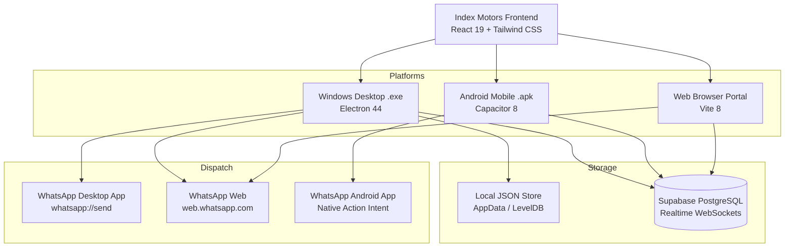
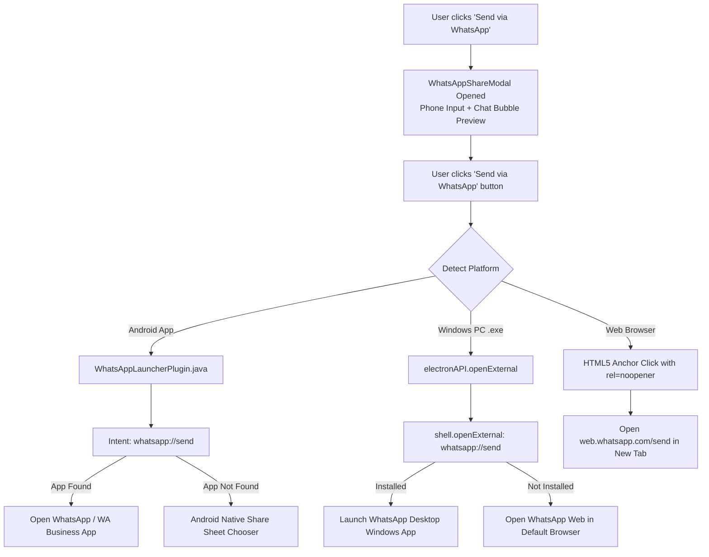

# Index Motors — System Documentation & Technical Manual
**Version 3.0.0 | Dealership & Commercial Vehicle Workshop Management System**

---

## 📌 Executive Overview

**Index Motors** is an enterprise-grade commercial dealership and heavy-duty workshop management suite tailored for **Swaraj Mazda** and **Tata** commercial trucks, lorries, tippers, and passenger fleet vehicles.

The system is engineered as an offline-capable, cross-platform hybrid application running natively across:
1. **Windows PC (`.exe`)**: High-performance desktop application with native OS shell integration and local JSON filesystem storage.
2. **Android Mobile (`.apk`)**: Native mobile application packaged via Capacitor with deep hardware and OS intent integration.
3. **Web Browser (Cloud CRM)**: Cloud-synced responsive portal powered by React 19 and Supabase Realtime.



---

## 🎨 Design System & Brand Identity

The interface is built around high-contrast, industrial workshop aesthetics using a **Precision Black & Red** color system:

| Token | Hex Value | Role |
| :--- | :--- | :--- |
| **Primary Red** | `#ef4444` / `#dc2626` | Action buttons, active badges, status accents, brand identity |
| **Deep Zinc / Black** | `#09090b` / `#18181b` | Main container background, sidebars, modals (anti-glare) |
| **Emerald Accent** | `#10b981` / `#059669` | WhatsApp buttons, payment settled badges, completion states |
| **Amber Warning** | `#f59e0b` / `#d97706` | Pending approvals, parts on order, high-priority repair flags |
| **Text High-Contrast** | `#ffffff` / `#f4f4f5` | Crystal clear readability under harsh workshop lighting |

---

## 💬 WhatsApp Integration Engine

The WhatsApp integration enables 1-click dispatch of formal commercial invoices and workshop job cards directly to fleet operators and vehicle owners without manual copy-pasting.

### 1. Cross-Platform Dispatch Architecture



### 2. Implementation Details

#### A. Android Native Intent Bridge (`WhatsAppLauncherPlugin.java`)
On Android 11+ (API 30+), external applications cannot be queried or launched without explicit declarations.

* **Android Manifest Declarations (`android/app/src/main/AndroidManifest.xml`)**:
  ```xml
  <queries>
      <package android:name="com.whatsapp" />
      <package android:name="com.whatsapp.w4b" />
      <intent>
          <action android:name="android.intent.action.VIEW" />
          <data android:scheme="whatsapp" />
      </intent>
      <intent>
          <action android:name="android.intent.action.VIEW" />
          <data android:scheme="https" />
      </intent>
  </queries>
  ```
* **Native Plugin Implementation (`WhatsAppLauncherPlugin.java`)**:
  - Registered via `registerPlugin(WhatsAppLauncherPlugin.class)` in `MainActivity.java`.
  - Fires an `Intent.ACTION_VIEW` targeting `whatsapp://send?phone=...&text=...`.
  - Automatically falls back to WhatsApp Business (`com.whatsapp.w4b`) or system share sheet if the standard app is absent.

#### B. Windows Desktop IPC Bridge (`electron/main.cjs` & `electron/preload.cjs`)
Electron security prevents renderer code from executing arbitrary protocol handlers directly.

* **Preload Exposure (`electron/preload.cjs`)**:
  ```javascript
  contextBridge.exposeInMainWorld('electronAPI', {
    isDesktop: true,
    openExternal: (url) => ipcRenderer.invoke('open-external', url),
    // ...
  });
  ```
* **Main Process Handler (`electron/main.cjs`)**:
  ```javascript
  ipcMain.handle('open-external', async (event, url) => {
    const allowed = ['https://', 'http://', 'whatsapp://', 'mailto:', 'tel:'];
    if (allowed.some(prefix => url.startsWith(prefix))) {
      await shell.openExternal(url);
      return { success: true };
    }
  });
  ```
* **Smart Windows Routing (`src/utils/whatsapp.js`)**:
  1. Tries `whatsapp://send?phone=...&text=...` to directly invoke **WhatsApp Desktop**.
  2. If not installed, falls back to `https://web.whatsapp.com/send?phone=...&text=...` in the user's default browser (Chrome/Edge).

### 3. Number Sanitization & Formatting
The helper `cleanPhoneNumber` in `src/utils/whatsapp.js` strips all formatting, spaces, dashes, and normalizes Indian mobile numbers:
* `+91 88485 55675` ➔ `918848555675`
* `08848555675` ➔ `918848555675`
* `8848555675` (10 digits) ➔ `918848555675`
* If left empty, WhatsApp launches the contact chooser automatically.

---

## 🗄 Storage & Auto-Refresh System

The application employs a dual-layer hybrid architecture ensuring zero data loss offline and instant collaboration online.

1. **Local Offline-First Storage**:
   - In the Windows `.exe`, data is saved to `%APPDATA%\Index Motors\index-motors-local-store.json`.
   - In Android and Web, data is stored with structured LocalStorage backup.
2. **Cloud Synchronization (Supabase)**:
   - Configured via environment variables `.env` (`VITE_SUPABASE_URL` and `VITE_SUPABASE_ANON_KEY`).
   - Tables: `trucks`, `leads`, `tasks`, `invoices`, `customers`, `settings`.
   - Realtime channels automatically re-fetch and re-render data on any remote insert/update.

---

## 🚛 Core Modules Overview

### 1. Commercial Vehicle Sales CRM
* **Swaraj Mazda & Tata Pipeline**: 5-stage tracking from *Lead* ➔ *Quotation* ➔ *Financing* ➔ *Booking Confirmed* ➔ *Delivered*.
* **Catalog**: Specifications and pricing for Swaraj Mazda BH Buses, Super GS Lorries, Samrat Tippers, and Sartaj Cargo trucks.
* **EMI Loan Calculator**: On-the-fly interest and installment calculation for Sundaram Finance, Cholamandalam, SBI, and HDFC.
* **Convert Deal to Invoice**: Generates formal vehicle sales invoice with 1 click.

### 2. Workshop Job Cards & Bay Management
* **Dual View**: Real-time Drag-and-Drop Kanban Board and Filterable Data Table.
* **Vehicle Spec Tracking**: Chassis VIN, license plate, current mileage, allocated workshop bay, and assigned lead technician.
* **Checklists**: Multi-point safety inspections with visual completion percentages.
* **Parts Allocation**: Tracks part numbers, quantities, unit prices, and subtotal calculations.
* **Job Card WhatsApp Dispatch**: Sends detailed repair progress, inspection status, and lead mechanic notes to the owner.

### 3. Commercial Billing & Invoices
* **Multiple Billing Types**: Workshop Service, Commercial Vehicle Showroom Sale, and Counter Parts Sale.
* **Accounting Breakdown**: Dynamic subtotaling, fleet discounts, GST / taxes, paid amounts, and live balance due.
* **Print Layout**: Dealership-formatted invoice with company logo, bank transfer details, and warranty terms.
* **Invoice WhatsApp Dispatch**: Sends complete itemized invoice breakdown and bank payment information directly to the customer.

---

## 🛠 Build & Deployment Guide

### Windows Desktop (`.exe`)

```powershell
# Navigate to project directory
cd C:\Users\user\.gemini\antigravity\scratch\index-motors-manager

# Build web assets and package both Installer and Portable executables
npm run electron:build
```

**Outputs generated in `release/`:**
* **Installer**: `release/Index Motors-Setup-3.0.0.exe` (NSIS installation with Desktop shortcut)
* **Portable**: `release/Index Motors-Portable-3.0.0.exe` (Standalone executable, no installation needed)

---

### Android Mobile App (`.apk`)

The mobile application is compiled through automated GitHub Actions CI with Java 21, Gradle 8.14, and Android Platform 36:

1. **Local Asset Synchronization**:
   ```powershell
   npm run build
   npx cap sync android
   ```
2. **Push to GitHub**:
   ```powershell
   git add -A
   git commit -m "Update mobile app"
   git push origin main
   ```
3. **Download Compiled APK**:
   Visit the GitHub Actions workflow at `https://github.com/cmshakir/index-motors-manager/actions` to download `Index-Motors-Debug.apk`.

---

## 🔧 Operational FAQ

* **WhatsApp Desktop on Windows**: If installed, launches WhatsApp Desktop immediately. Otherwise, opens WhatsApp Web in your default browser.
* **Android Permissions**: The Android APK declares `<queries>` in its manifest. If prompted the first time, select "Always open with WhatsApp".
* **Local Data Backup**: Access your local JSON database anytime from the Windows app menu: **File ➔ Open Local Data Folder**.
