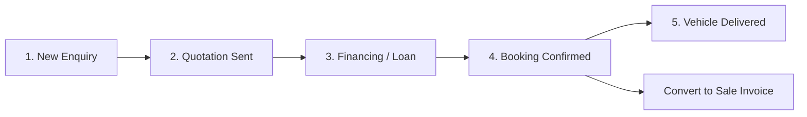
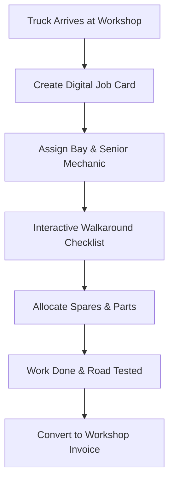
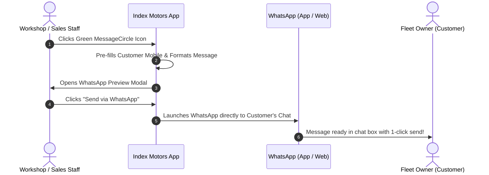

# 📖 Index Motors — End-User Instruction Manual
**Operating Guide & Standard Procedures (SOP) | Version 3.0.0**

Welcome to **Index Motors Dealership & Workshop Management System**. This user guide will walk you through daily dealership operations, workshop task tracking, commercial billing, and 1-click WhatsApp customer dispatch across your Windows PC and Android phone.

---

## 🚀 Quick Navigation

* [1. Getting Started & Installation](#1-getting-started--installation)
* [2. User Roles & Login](#2-user-roles--login)
* [3. Commercial Vehicle Sales CRM (Swaraj Mazda & Tata)](#3-commercial-vehicle-sales-crm)
* [4. Workshop Job Cards & Bay Management](#4-workshop-job-cards--bay-management)
* [5. How to Send Updates & Invoices via WhatsApp](#5-how-to-send-updates--invoices-via-whatsapp)
* [6. Commercial Invoicing & Payment Settlements](#6-commercial-invoicing--payment-settlements)
* [7. Fleet Vehicles & Customer Accounts](#7-fleet-vehicles--customer-accounts)
* [8. Offline Storage, Realtime Sync & Backups](#8-offline-storage-realtime-sync--backups)

---

## 1. Getting Started & Installation

### 💻 Using on Windows PC
You have two easy ways to run Index Motors on your dealership computer:

1. **Desktop Installer (Recommended)**:
   * Double-click `Index Motors-Setup-3.0.0.exe`.
   * Follow the quick setup steps. An **Index Motors** shortcut will appear on your Desktop and Start Menu.
2. **Portable Version (No installation required)**:
   * Double-click `Index Motors-Portable-3.0.0.exe`. The app opens instantly. Ideal for carrying on a USB pendrive.

### 📱 Using on Android Phone / Tablet
1. Download the `Index-Motors-Debug.apk` from your dealership link or GitHub Actions.
2. Open the file on your Android device and tap **Install** (if prompted, tap *Allow installation from this source*).
3. Open the **Index Motors** app from your home screen.

---

## 2. User Roles & Login

When you launch Index Motors, you can choose your profile or use the fast **1-Click Staff Login** buttons:

| Staff Member | Dealership Role | Primary Responsibilities |
| :--- | :--- | :--- |
| **Rajesh K.** | **General Manager** | Full access to financial dashboards, staff assignments, and all reports |
| **Arun Menon** | **Commercial Sales Manager** | Truck & Bus sales pipeline, lead quotes, EMI loan estimates, sales invoices |
| **Ramesh Chandran** | **Workshop Foreman** | Floor bays, vehicle check-ins, job cards, mechanics, inspection checklists |
| **Deepa Nair** | **Accounts & Billing** | GST billing, payment collections, cash/bank records, printable invoices |

> [!TIP]
> Tap any staff member's avatar on the login screen to sign in instantly without typing your password.

---

## 3. Commercial Vehicle Sales CRM

Manage your **Swaraj Mazda** and **Tata** vehicle sales pipeline from initial buyer inquiry to delivery.

### How to Create a New Sales Deal:
1. Click **Sales CRM** in the left sidebar menu.
2. Click the red **+ New Commercial Lead** button in the top right.
3. Fill in the buyer's details:
   * **Customer / Fleet Name**: e.g., *Malabar Heavy Haulage*
   * **Phone Number**: e.g., `+91 98470 12345`
   * **Vehicle Model**: Choose from the Swaraj Mazda & Tata catalog:
     - *Swaraj Mazda Super GS Commercial Lorry* (₹16.5L)
     - *Swaraj Mazda Samrat HD Tipper* (₹17.8L)
     - *Swaraj Mazda Sartaj 5252 XM Cargo Truck* (₹13.5L)
     - *Swaraj Mazda BH Series 32-Seater Bus* (₹22.8L)
     - *Tata Prima / Signa Heavy Hauler*
   * **Expected Closing Date** & **Deal Value**.
4. Click **Create Lead**.

### Using the Commercial Loan EMI Calculator:
1. Inside the Sales CRM, click **Loan EMI Calculator**.
2. Select the truck price, enter the buyer's **Down Payment Amount** (e.g., 20%), and pick the **Tenure** (36, 48, or 60 months).
3. Select the preferred finance bank (*Sundaram Finance, Cholamandalam, SBI, or HDFC*).
4. Instantly view the monthly installment to quote to the customer!

### Converting a Confirmed Booking into an Invoice:
When the customer pays their booking token advance:
1. Drag the lead card to the **Booking Confirmed** column.
2. Click the **Convert to Invoice** button on the deal card.
3. The system automatically populates a formal Dealership Sale Invoice with vehicle specifications, price, and token advance deduction!

---

## 4. Workshop Job Cards & Bay Management

Keep heavy commercial repair jobs organized with live Bay tracking and digital checklists.

### How to Log a Truck for Service:
1. Click **Workshop Tasks** in the sidebar.
2. Click **+ New Job Card**.
3. Select or enter:
   * **Customer Account**: Select existing fleet or add new.
   * **Truck Details**: Select truck model (e.g., *Swaraj Mazda Sartaj* or *Tata LPT*), enter License Plate & VIN.
   * **Odometer Reading**: Current km on meter.
   * **Assigned Bay**: Select Bay (e.g., *Bay 1 - Heavy Lift*, *Bay 2 - Engine Overhaul*, *Bay 3 - Electrical*).
   * **Lead Technician**: Select attending mechanic.
4. **Safety Inspection Checklist**:
   * Tick initial inspection checkpoints (*Fluid levels, air brakes, tyre pressure, steering play*).
   * Add custom checkpoints if needed.
5. **Add Spare Parts & Materials**:
   * Add parts used (e.g., *Oil Filter, Heavy Brake Shoes, Synthetic Engine Oil*).
6. Click **Save Job Card**.

### Changing Job Card Status:
* **Kanban Mode**: Simply drag and drop the vehicle card between columns:
  * `Received / Pending` ➔ `In Progress (Bay Work)` ➔ `Awaiting Parts` ➔ `Quality Check / Ready`.
* **Table Mode**: Click the status badge on any row to change it immediately.

---

## 5. How to Send Updates & Invoices via WhatsApp

You can send professional formatted updates and invoices directly to customer WhatsApp chats with a single click.

### Step-by-Step WhatsApp Sending:

1. **Find the WhatsApp Button**:
   * On any **Invoice** row or invoice print view: Click the green **WhatsApp** icon.
   * On any **Job Card** card or details view: Click the green **WhatsApp Job Card** button.
2. **Review the Message**:
   * The **WhatsApp Dispatch Modal** opens.
   * Verify the **Recipient WhatsApp Number** (it defaults to the customer's phone).
   * Review the clean chat bubble preview containing the company header, invoice amount/balance, or workshop repair status.
   * *(Optional)*: Click **Customise Text** if you wish to add personal notes.
3. **Click "Send via WhatsApp"**:
   * **On your Windows PC**: If **WhatsApp Desktop** is installed, it launches the app immediately to the customer's chat. If not installed, it opens **WhatsApp Web** in your default browser!
   * **On your Android Phone**: Launches the native **WhatsApp** or **WhatsApp Business** app directly into the customer's conversation with the message ready in the input field!
4. **Tap Send in WhatsApp**:
   * Press the send arrow inside WhatsApp. The formatted message is delivered with bold highlights and emojis!

> [!NOTE]
> If a customer's phone number is left blank, WhatsApp automatically opens your **Contacts List** so you can pick who to send to.

---

## 6. Commercial Invoicing & Payment Settlements

Index Motors supports 3 billing categories:
* 🔧 **Workshop Repair & Service Billing**
* 🚛 **Commercial Vehicle Sales Billing**
* ⚙️ **Parts & Spares Counter Sale**

### How to Create an Invoice:
1. Click **Invoices & Billing** in the sidebar.
2. Click **+ New Invoice**.
3. Select the **Customer**, **Invoice Type**, and **Truck Details**.
4. Add line items (Description, Quantity, Unit Price).
5. Apply any applicable **Fleet Discount %** or **GST Tax %**.
6. Enter any **Advance Paid Amount**. The system calculates the **Balance Due** automatically.
7. Click **Generate Invoice**.

### How to Record Customer Payments:
1. Open the invoice from the table.
2. Click **Record Payment**.
3. Enter the amount received, date, and payment mode (*Cash, Bank Transfer / NEFT, UPI / GPay, Cheque*).
4. If fully paid, the status badge turns **PAID** (green). If partial, it displays **PARTIAL** with remaining balance due.

### How to Print an Official Invoice:
1. Click the **View / Eye** icon on any invoice row.
2. Click the **Print Invoice** button at the top right.
3. The system formats a commercial dealership document with Index Motors branding, GST details, warranty terms, bank transfer account details, and signature stamps.
4. Select your printer or choose **Save as PDF**.

---

## 7. Fleet Vehicles & Customer Accounts

### Managing Trucks & Lorries Inventory:
* Click **Vehicles** in the sidebar.
* **Dealership Stock**: Trucks available for showroom sale (tracked by Chassis, Model, Year, Asking Price, Status: *Available, Reserved, Sold*).
* **Customer Fleet Trucks**: Active workshop vehicles registered with company owners, plates, and service logs.

### Managing Fleet Client Accounts:
* Click **Customers** in the sidebar.
* View total spent, active vehicle count, credit limits, and outstanding receivable balance.
* Click any customer to view their complete vehicle history, all past job cards, and invoices.

---

## 8. Offline Storage, Realtime Sync & Backups

Index Motors is built to never lose data, even if your workshop internet connection drops.

### 1. Offline Mode (Local Storage)
* Every time you add or edit a record, it is saved instantly to your computer's hard drive or phone's local storage.
* You can continue working without an internet connection.

### 2. Auto-Refresh & Cloud Realtime
* When an internet connection is active, the app automatically synchronizes with the cloud database.
* If a technician updates a Job Card on an Android phone in Bay 2, the Reception PC table updates **automatically in real time** without pressing refresh!

### 3. Creating a Safe Database Backup (PC):
1. In the Windows application top menu, click:
   **File ➔ Open Local Data Folder**
2. Copy the file `index-motors-local-store.json` to a safe location (e.g., Google Drive or a backup USB drive).
3. Alternatively, open **Settings** inside the app and click **Export Complete Backup (JSON)**.

---

## 💡 Quick Reference Shortcut Cheatsheet

| Task | Quick Action |
| :--- | :--- |
| **Send WhatsApp to Customer** | Click the green **MessageCircle** icon on any row |
| **Move Workshop Job Status** | Drag and drop the task card in Kanban view |
| **Print Work Order / Job Card** | Click Job Card ➔ Click **Print Work Order** |
| **Print Tax Invoice** | Open Invoice ➔ Click **Print Invoice** |
| **Switch Staff Roles** | Click user avatar at the bottom left ➔ Select user |
| **Switch Table / Kanban View** | Click the **Kanban** or **Table** pill above the list |
| **Search Anything** | Type License Plate, Invoice #, or Customer Name in the top search bar |

---

*Index Motors Commercial Management System | Support & Helpline: +91 8848555675 | Pallipadi, Gudallur*
